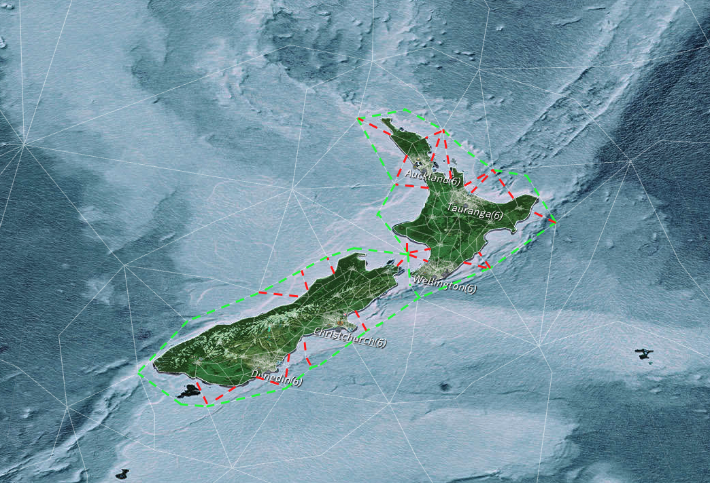

# Fury Road Definitions & Sanctions

DRAFT for staff review · 16 November 2026

This page sets out the global definitions we used when running events on the Fury Road server, and the sanctions that apply where an individual event's rules enforce them.
{: .plain}

## Definitions {#definitions}

### Act of war {#act-of-war}

- Any violation of a nation's territory (see [Nation's territory](#nations-territory)), by air (see [Flyover](#flyover)), land, or sea, constitutes an act of war.
- The nation whose territory is violated has the right to defend that territory until the threat is removed.
- Defensive actions taken for this purpose will not result in moderator punishment or repercussions.
- If a truce is in effect, the defending nation must cease all defensive actions once the threat has been removed from its territory.
- At that point, all nations must accept peace.

### Conspiracy {#conspiracy}

If not explicitly permitted by the event rules, **working with another team** is prohibited.

This includes, but is not limited to:

- Resource trading or transfers
- Coordinated battle planning
- Sharing intelligence or reconnaissance information

Conspiracy is **not limited to the examples above** and covers **any coordination or communication that provides a competitive advantage** between teams that are intended to act independently.

Incidental or non-gameplay communication (for example general chat or greetings) is not considered conspiracy unless it directly influences in-game actions.

### Espionage {#espionage}

Collecting information through spies in order to better serve another country's agenda or military planning. This includes all forms of spies.

### Failing to make peace {#failing-to-make-peace}

During any period in which engaging another country's troops is deemed illegal (a **TRUCE**), all affected countries are required to **make and maintain peace**.

Any country that **refuses or fails to make peace** during an active TRUCE will be subject to a sanction.

### Flyover {#flyover}

{: .side}

A flyover is any instance where an air unit passes through, circles above, or briefly enters a nation's territory, including territorial waters.

For example, this counts as a flyover, as the patrol radius overlaps another nation's territory.

### Gold usage {#gold-usage}

Any in-game action performed using premium currency (Gold), including but not limited to unit rushing, resource purchases, building acceleration, unit healing, and espionage.

### Market blocking {#market-blocking}

Market blocking is defined as posting a significantly different price from the game's market price for a resource *unless* the market has already moved there by 0.1 steps.

When using the market:

- Sell resources as high as possible
- Buy resources as low as possible
- All trades must be pre-coordinated
- Offers may not stay up long

### Restricted unit usage {#restricted-unit-usage}

The research, mobilisation, deployment, or active use of any unit type designated as restricted for the event.

### Unjustified engagement {#unjustified-engagement}

If a country uses its units to engage another nation's or player's units during a truce, when that is not allowed, it has committed an Unjustified Engagement.

## Map terms {#map-terms}

### Nation's territory {#nations-territory}

{: .side}

**A nation's territory consists of:**

- Its assigned **starting land mass** (homeland cities and provinces)
- **Territorial waters** immediately surrounding those homeland cities and provinces
- **Airspace** above both homeland land and territorial waters
- Any **occupied territories**

### Territorial waters {#territorial-waters}

{: .side}

A nation's territorial waters:

- begin where the nation's land meets the water
- extend outward from each connection to the first sea-connection vertex
- That set of vertices and the paths that connect them forms the boundary of a nation's territorial waters.
- All nations may traverse paths that connect sea-connection vertices.
- No nation may traverse a path that connects a sea-connection vertex directly to another nation's land.

In the example, the green paths can be navigated and the red cannot.

## Sanctions {#sanctions}

Where an event prohibits something and a team breaches the rule, the breach typically results in an economic sanction. The table below gives the sanction for each term.

- All sanctions are payable to the event moderator.
- If a sanction cannot be paid immediately, the offending party may not conquer any territory or mobilise additional units until it is paid in full, including during any period of truce.
- Failure or refusal to pay a sanction results in immediate disqualification.

| Term | Sanction |
| --- | --- |
| [Act of war](#act-of-war) | 500 Electronics 1000 Rare materials |
| [Conspiracy](#conspiracy) | 1000 Rare materials per team member |
| [Espionage](#espionage) | 1000 Components 1000 Electronics |
| [Failing to make peace](#failing-to-make-peace) | 1000 Supplies 500 Rare materials |
| [Flyover](#flyover) | A flyover is an [act of war](#act-of-war), so the same sanction applies: 500 Electronics 1000 Rare materials |
| [Gold usage](#gold-usage) | Disqualification from the event unless self-reported. If self-reported, the sanction depends on the use: **Accelerate construction:** building level is reset to its pre-gold level **Accelerate mobilisation:** the accelerated units are forfeit **Accelerate research:** economic fine of the research cost **Healing units:** the healed units are forfeit **Resource purchase:** the resources are sold to the moderator, with no cash benefit |
| [Market blocking](#market-blocking) | The value of the resources used to block the market |
| [Restricted unit usage](#restricted-unit-usage) | The units are destroyed |
| [Unjustified engagement](#unjustified-engagement) | 1.5 × cost in each of Supplies, Components, Fuel, Electronics, Cash and Rare materials, per damaged unit |

## Support {#support}

If any definition or sanction is unclear, please feel free to raise a support ticket in [#support-tickets](https://discord.com/channels/1464807025815978110/1464887983332134933) on the Fury Road Discord server.

## Notes for staff (remove before publishing) {#staff-notes}

**Edits from the original definitions**

- Typos fixed: "boundy" → "boundary", "a paths" → "paths", "Each team choose" → "chooses", "nations territory" → "a nation's territory", stray double spaces.
- Cross-references between Nation's territory, Flyover and Act of war are now links on this page.
- The old **Violations** section is now **Definitions**, since a term only counts as a violation if an event's rules prohibit it. The **Flyover** example now says "counts as a flyover" rather than "a violation of airspace".
- The **#sanctions** channel is folded into the **Sanctions** section above. Its channel links became term links, and the Gold usage breakdown moved into the table.
- **Espionage** and **Unjustified engagement** are reworded for readability. Please confirm the meaning is unchanged.
- The two traversal bullets are removed from **Nation's territory**, since they repeat under **Territorial waters**.

**Open questions**

1. **Market blocking:** what does "moved there by 0.1 steps" mean in game terms? Does "All trades must be pre-coordinated" conflict with **Conspiracy**?
2. **Nation's territory image:** the caption is neutral. What is the red line in the screenshot showing?
3. A one-line "what this means for you" under each term, as the server review suggested. Not written yet, as it would be guessing at intent.
