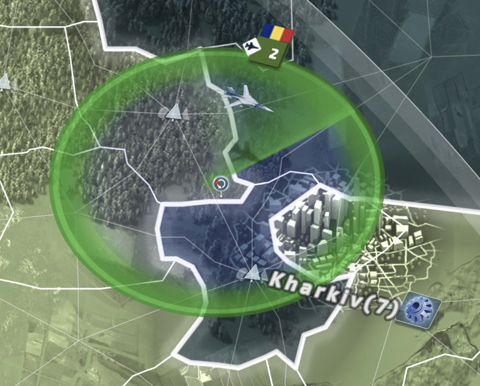
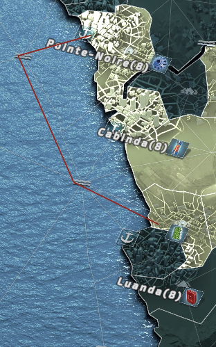

# Fury Road Definitions

DRAFT for staff review · 16 November 2026

These are the standing terms every Fury Road event uses. They define what counts as a violation and what the map terms mean. The rules for a specific event, including which of these apply and its win condition, are on that event's poster. Nothing here is final until staff sign off.

## Violations {#violations}

### Act of war {#act-of-war}

- Any violation of a nation's territory (see [Nation's territory](#nations-territory)), by air (see [Flyover](#flyover)), land, or sea, constitutes an act of war.
- The nation whose territory is violated has the right to defend that territory until the threat is removed.
- Defensive actions taken for this purpose will not result in moderator punishment or repercussions.
- If a truce is in effect, the defending nation must cease all defensive actions once the threat has been removed from its territory.
- At that point, all nations must accept peace.

### Conspiracy {#conspiracy}

If not explicitly permitted by the event rules, **working with another team** is prohibited.

This includes, but is not limited to:

- Resource trading or transfers
- Coordinated battle planning
- Sharing intelligence or reconnaissance information

Conspiracy is **not limited to the examples above** and covers **any coordination or communication that provides a competitive advantage** between teams that are intended to act independently.

Incidental or non-gameplay communication (for example general chat or greetings) is not considered conspiracy unless it directly influences in-game actions.

### Espionage {#espionage}

Collecting information through spies in order to better serve another country's agenda or military planning. This includes all forms of spies.

### Failing to make peace {#failing-to-make-peace}

During any period in which engaging another country's troops is deemed illegal (a **TRUCE**), all affected countries are required to **make and maintain peace**.

Any country that **refuses or fails to make peace** during an active TRUCE will be subject to a sanction.

### Flyover {#flyover}

A flyover is any instance where an air unit passes through, circles above, or briefly enters a nation's territory, including territorial waters.

For example, this would be considered a violation of a nation's airspace, as the patrol radius overlaps another nation's territory.

### Gold usage {#gold-usage}

Any in-game action performed using premium currency (Gold), including but not limited to unit rushing, resource purchases, building acceleration, unit healing, and espionage.

### Market blocking {#market-blocking}

Market blocking is defined as posting a significantly different price from the game's market price for a resource *unless* the market has already moved there by 0.1 steps.

When using the market:

- Sell resources as high as possible
- Buy resources as low as possible
- All trades must be pre-coordinated
- Offers may not stay up long

### Restricted unit usage {#restricted-unit-usage}

The research, mobilisation, deployment, or active use of any unit type designated as restricted for the event.

### Unjustified engagement {#unjustified-engagement}

If a country uses its units to engage another nation's or player's units during a truce, when that is not allowed, it has committed an Unjustified Engagement.

## Map terms {#map-terms}

### Nation's territory {#nations-territory}

**A nation's territory consists of:**

- Its assigned **starting land mass** (homeland cities and provinces)
- **Territorial waters** immediately surrounding those homeland cities and provinces
- **Airspace** above both homeland land and territorial waters
- Any **occupied territories**

### Territorial waters {#territorial-waters}

A nation's territorial waters:

- begin where the nation's land meets the water
- extend outward from each connection to the first sea-connection vertex
- That set of vertices and the paths that connect them forms the boundary of a nation's territorial waters.
- All nations may traverse paths that connect sea-connection vertices.
- No nation may traverse a path that connects a sea-connection vertex directly to another nation's land.

In the example, the green paths can be navigated and the red cannot.

## Notes for staff (remove before publishing) {#staff-notes}

**Edits from the original definitions**

- Typos fixed: "boundy" → "boundary", "a paths" → "paths", "Each team choose" → "chooses", "nations territory" → "a nation's territory", stray double spaces.
- Cross-references between Nation's territory, Flyover and Act of war are now links on this page.
- **Espionage** and **Unjustified engagement** are reworded for readability. Please confirm the meaning is unchanged.
- The two traversal bullets are removed from **Nation's territory**, since they repeat under **Territorial waters**.

**Open questions**

1. **Market blocking:** what does "moved there by 0.1 steps" mean in game terms? Does "All trades must be pre-coordinated" conflict with **Conspiracy**?
2. **Grouping:** **Flyover** and **Act of war** are really about territory. Move them next to the Map terms?
3. **Images:** the three screenshots come from the original definition channels. Check they still make sense, and caption **Nation's territory** properly (what is the red line showing?).
4. A one-line "what this means for you" under each term, as the server review suggested. Not written yet, as it would be guessing at intent.
